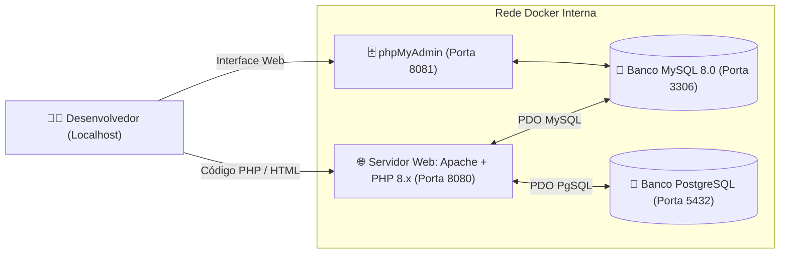

# 🐳 Ambiente PHP + MySQL + PostgreSQL + Apache via Docker

<div align="center">

[](https://www.docker.com/)
[](https://www.php.net/)
[](https://www.mysql.com/)
[](https://www.postgresql.org/)
[](https://www.phpmyadmin.net/)

**Stack pronta, leve e configurada para desenvolvimento de aplicações web em PHP com suporte nativo a bancos relacionais MySQL e PostgreSQL.**

</div>

---

## 📐 Topologia dos Serviços



---

## 🚀 Como Subir o Ambiente em 1 Comando

```bash
# 1. Clonar este repositório
git clone https://github.com/ed1rac/php-mysql-postgres-docker-env.git
cd php-mysql-postgres-docker-env

# 2. Iniciar todos os containers em segundo plano
docker compose up -d
```

---

## 🌐 Portas e Acessos Padrão

| Serviço | URL / Porta | Credenciais Padrão |
| :--- | :--- | :--- |
| **Aplicação PHP** | [http://localhost:8080](http://localhost:8080) | Os arquivos colocados na pasta `./html` aparecem aqui |
| **phpMyAdmin** | [http://localhost:8081](http://localhost:8081) | Servidor: `mysql`, Usuário: `root`, Senha: `rootpassword` |
| **MySQL DB** | `localhost:3306` | Banco: `meubanco`, Usuário: `user`, Senha: `password` |
| **PostgreSQL DB** | `localhost:5432` | Banco: `meubanco`, Usuário: `user`, Senha: `password` |

---

## 🛑 Parar ou Reiniciar o Ambiente

```bash
docker compose down      # Parar os containers
docker compose logs -f   # Acompanhar os logs em tempo real
```

---

## ☕ Apoie o Projeto (Me Pague um Café / Buy Me a Coffee)

Este projeto é desenvolvido com dedicação e carinho à disseminação do conhecimento e da tecnologia. Se ele foi útil para os seus estudos, aulas, trabalho ou produtividade diária e você quiser apoiar o desenvolvimento contínuo:

- ☕ **Buy Me a Coffee (Internacional / Cartão / QR Code)**:
  - 👉 **[https://buymeacoffee.com/edkallenn](https://buymeacoffee.com/edkallenn)**
  - [](https://buymeacoffee.com/edkallenn)
  - Escaneie o QR Code abaixo com a câmera do celular para abrir diretamente:

<div align="center">
  <a href="https://buymeacoffee.com/edkallenn" target="_blank">
    
  </a>
</div>

- 🇧🇷 **PIX (Brasil — Qualquer valor, taxa zero)**:
  - **Chave PIX (E-mail)**: `edkevan@gmail.com`
  - **Titular**: Edkallenn Silva de Lima

Muito obrigado pelo apoio! 🚀

---
